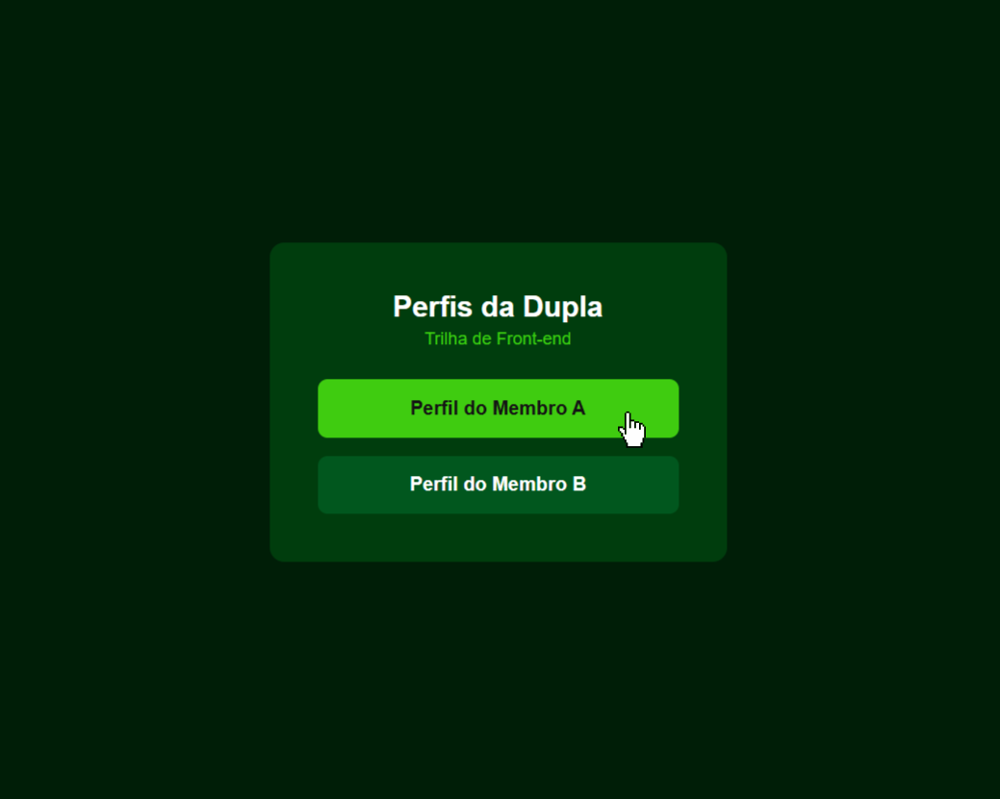
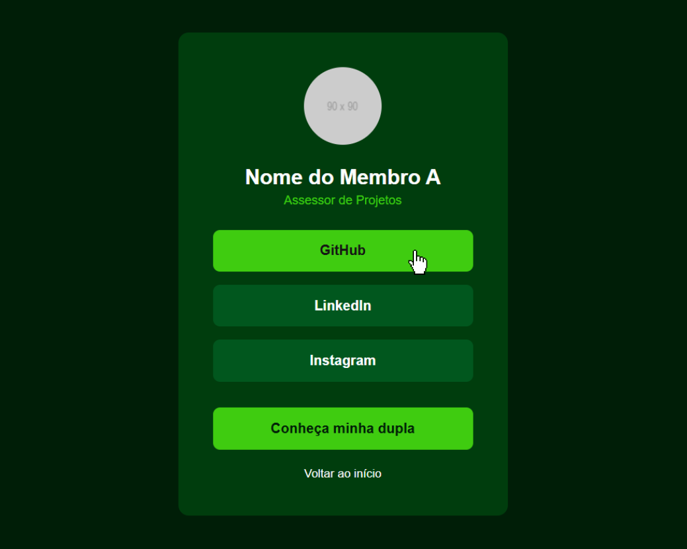
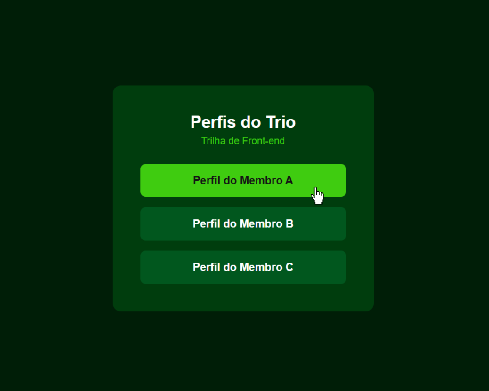
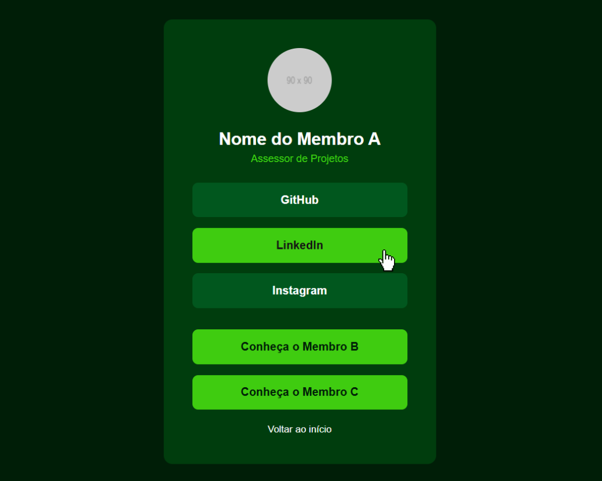

# 🕵️ Operação Ficha Secreta
**Desafio 01 | Trilha Front-end | Orc'estra Gamificação**

### 📜 Anteriormente
O antigo sistema da nossa Agência foi comprometido. Um ataque cibernético derrubou nossos servidores na noite passada e agora nossos agentes em campo estão isolados, incapazes de identificar quem é aliado e sem meios para acionar suas equipes.

Para evitar novos ataques, o Comando tomou uma decisão drástica: não usaremos sistemas complexos prontos. A nova rede de identificação será construída puramente com os fundamentos da web, de forma direta e invisível para os inimigos.

---

### 🧙 O Capítulo
A tela do seu computador pisca e a voz do Comando da Agência ecoa no fone de ouvido. 

"Vocês foram ativados. A Agência precisa que vocês reconstruam o banco de identidades da equipe. Uma ficha de perfil isolada é um alvo fácil. A verdadeira segurança está no trabalho da sua equipe. 

Vocês vão criar as **Fichas Secretas** da equipe de vocês. E lembrem-se: os arquivos devem estar interligados por rotas seguras. Se eu abrir o seu perfil, preciso conseguir acessar a página dos seus parceiros com um único clique."

---

### 🎯 Sua missão
A sua equipe (dupla ou trio) deve construir os perfis de identificação na nossa nova rede. O sistema será composto por um painel inicial e uma página de Perfil individual para cada membro, **todas interligadas**.

**O que a Ficha (Cartão de Perfil) de cada agente precisa ter:**
- Imagem ou foto (o seu avatar de agente)
- Nome real e cargo na Orc'estra
- No mínimo **3 links de comunicação** (GitHub, LinkedIn, Instagram, etc.)
- **Botões de Conexão:** Botões no final da ficha que redirecionem imediatamente para a página do(s) parceiro(s) da sua equipe.

**Regra de Ouro (Camuflagem Padrão):** 
Vocês têm liberdade criativa total para a identidade visual das fichas. Podem seguir um tema de espionagem, usar as cores da Orc'estra ou inventar um estilo próprio. A única exigência é que a identidade visual escolhida seja consistente entre todos os membros da equipe. A escolha das 3 redes sociais e a foto também são livres.

<div align="center">
  
  
  <br />
  
  
</div>

---

### ⚔️ Protocolos de Segurança (As Restrições)
Para ganhar o Acesso Liberado, o código de vocês precisa resistir às auditorias do Comando:

| Auditoria | Nome | O que ela testa |
| :--- | :--- | :--- |
| 1 | Código Limpo | O uso exclusivo de **HTML e CSS puro**. É estritamente proibido o uso de JavaScript ou frameworks (como Tailwind ou Bootstrap). Códigos prontos geram rastros. |
| 2 | A Identidade Visual | Todas as fichas devem apresentar o mesmo padrão e consistência visual. |
| 3 | A Rota Segura | A navegação. Os botões de conexão devem funcionar perfeitamente usando apenas **caminhos relativos** (ex: `href="membro-b.html"`). |
| 4 | Dados Obrigatórios | A presença obrigatória da foto, nome, cargo, 3 contatos e os botões de ligação com a equipe em todos os perfis. |
| ?&$ | A Varredura Final | Auditorias ocultas testando a organização do código, alinhamento e como vocês trabalharam juntos no GitHub. |

**Não existe vitória parcial.** Passar em 3 de 4 é falha na missão. E passar nas 4 auditorias visíveis ainda não garante o Acesso Liberado: a Varredura Final só acontece na correção.

> 💡 A Varredura Final existe para premiar quem realmente compreendeu como organizar e estilizar uma página, e não quem apenas copiou blocos de código prontos sem entender como funcionam.

---

### 🧭 Como operar, passo a passo

1. **A Base de Operações:** Como ensinado no `README.md` principal do repositório, vocês já devem ter o repositório "forkado". Definam quem será o "Dono do Fork" desta semana e adicionem o(s) parceiro(s) como colaborador(es) no GitHub.
2. **Sincronize e Crie a Rota:** O Dono do Fork deve sincronizar a base para puxar este desafio novo. Em seguida, a partir da `main` atualizada, criem a branch da missão (ex: `git checkout -b desafio01`).
3. **Acesse a Pasta de Entrega:** No terminal, entrem no diretório do desafio e naveguem até a pasta de entrega (ex: `cd desafio01/entrega/`). É **exclusivamente** aqui dentro que o código de vocês deve existir. Não alterem o `README.md` da missão nem a pasta de `assets/` originais.
4. **Dividam as tarefas:** Cada membro fica responsável por codificar e estilizar o seu próprio perfil (`.html` e `.css`) dentro da pasta `entrega/`. O painel inicial (`index.html`) deve ser feito em conjunto.
5. **Subam para o Fork:** Façam commits pequenos e enviem as alterações (`git push origin desafio01`) para o Fork compartilhado da equipe. Se os dois alterarem o `index.html` ao mesmo tempo e der conflito (*Merge Conflict*), resolvam juntos.
6. **Preencham o Relatório:** Abram o arquivo modelo `ENTREGA.md` (que já está esperando vocês dentro da pasta `entrega/`), preencham com os dados e reflexões da equipe, e façam o commit dele.
7. **A Entrega Oficial (Pull Request):** Com o código rodando perfeitamente, abram um único Pull Request apontando a branch do desafio de vocês para a branch `main` do **repositório original da Agência**. O título deve ser `[Desafio 01] Nome 1 e Nome 2`. **Não façam o merge.** Quem avalia a missão e fecha o PR é a DiProj.

---

### 🗺️ Conhecendo o seu projeto
No repositório do desafio, a estrutura da pasta de vocês deve ficar exatamente assim:

**Se a sua equipe é uma DUPLA:**
```text
desafio-frontend-01/
└── entregas/
    ├── ENTREGA.md
    ├── style.css         ← O estilo do projeto (se forem usar mais de um arquivo, criem uma pasta de estilos)
    ├── index.html        ← Painel inicial (botões para os 2 membros)
    ├── membro-a.html     ← Perfil do Agente A (linka para o Agente B)
    └── membro-b.html     ← Perfil do Agente B (linka para o Agente A)
```

**Se a sua equipe é um TRIO:**
```text
desafio-frontend-01/
└── entregas/
    ├── ENTREGA.md
    ├── style.css         ← O estilo do projeto (se forem usar mais de um arquivo, criem uma pasta de estilos)
    ├── index.html        ← Painel inicial (botões para os 3 membros)
    ├── membro-a.html     ← Perfil do Agente A (linka para B e C)
    ├── membro-b.html     ← Perfil do Agente B (linka para A e C)
    └── membro-c.html     ← Perfil do Agente C (linka para A e B)
```

---

### 📏 Regras da Missão
- **Proibido:**
    - Usar JavaScript.
    - Usar frameworks ou bibliotecas (Tailwind, Bootstrap).
    - **Alterar o `README.md` ou qualquer outro arquivo base do repositório. O código da sua equipe deve existir exclusivamente dentro da pasta de vocês.**

- **Permitido:** Usar bibliotecas de ícones via link no HTML (FontAwesome, Phosphor Icons) ou Emojis.

- **Ferramentas de IA:** Permitidas para tirar dúvidas (ex: "Como funciona a margem no CSS?"). Pedir o código pronto destrói o propósito de aprender, e a Varredura Final descobrirá se isso aconteceu.

- Vocês precisam saber explicar qualquer linha do seu código se o assessor perguntar.

---

### 🏆 Recompensas e pontuação
O Acesso Liberado só é concedido se a equipe passar nas 4 auditorias visíveis e na Varredura Final.

Além disso, cada agente ganha Pontos de Inteligência para o ranking:

| Critério | Pontos |
| :--- | :--- |
| Missão concluída (navegação e restrições respeitadas) | 50 |
| Qualidade do código (arquitetura limpa, classes com nomes claros, HTML correto) | 20 |
| Consistência Visual (O tema foi bem aplicado e unificado entre a equipe) | 20 |
| Relatório `ENTREGA.md` preenchido detalhadamente | 10 |
| **Bônus:** Transições de cores suaves ao passar o mouse nos botões (*hover*) | +2 |
| **Bônus:** Perfil responsivo (não quebra ao diminuir a tela do navegador) | +3 |
| **Total** | **100 + 5** |

- Atraso na entrega: desconto de 10 pontos.
- Códigos iguais aos de outras equipes sem saber explicar: zera o ENTREGA.md e a qualidade do código, e abre conversa individual.
- Todo membro recebe 3 pontos fortes e 3 pontos de melhoria como comentários no Pull Request.

Boa sorte, agentes. O Comando aguarda os perfis. 🌐🕵️‍♂️

---

### 📝 Modelo do Relatório ENTREGA.md

```markdown
# Relatório - Desafio 01: Ficha Secreta
**Equipe:** [Nome 1], [Nome 2], (opcional: [Nome 3])
**Data do Relatório:** 

## Link Externo (Opcional)
- (Se subiram o site em algum lugar como Vercel ou GitHub Pages, coloquem o link aqui).

## Evidências
- (Anexem prints da tela final dos perfis funcionando no navegador)

## Dificuldades da Equipe
(Descrevam os obstáculos. O Flexbox foi difícil? O alinhamento visual com o parceiro causou conflitos no GitHub? Como resolveram?)

## Perguntas de Reflexão
1. Durante o desafio, como vocês se organizaram para garantir que a identidade visual ficasse unificada em todos os perfis?
2. Ao construir o layout sem frameworks, qual conceito de HTML ou CSS puro (como Flexbox, responsividade ou hierarquia) ficou mais claro para a equipe?
```