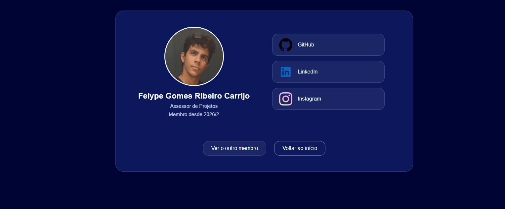
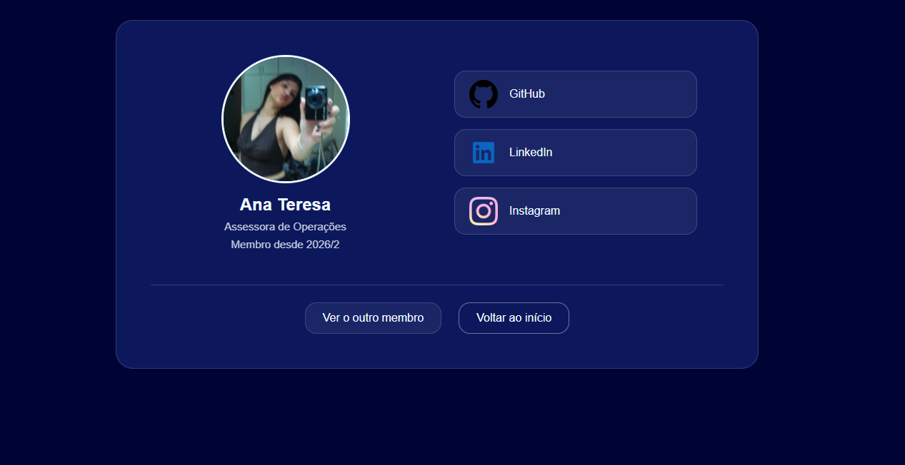

# Relatório - Desafio 01: Ficha Secreta
**Equipe:** Felype Gomes, Ana Teres
**Data do Relatório:** 25/10/2026

## Link Externo (Opcional)
- Não se aplica. O projeto foi desenvolvido e validado localmente, sem publicação em Vercel ou GitHub Pages.

## Evidências

As capturas abaixo mostram o resultado final no navegador: o painel inicial e os dois perfis, todos interligados por caminhos relativos. A navegação foi testada clicando nos cards do painel, nos links de contato e nos botões de conexão entre os membros.

### Painel inicial (`index.html`)

  

O painel apresenta os dois integrantes em cards com foto, nome e cargo. Cada card funciona como um link para a ficha individual do respectivo agente.

### Perfil do Felype (`membro-a.html`)

  

A ficha reúne foto, nome completo, cargo, os três links de comunicação (GitHub, LinkedIn e Instagram), o botão para acessar o perfil da parceira e o botão de retorno ao painel inicial.

### Perfil da Ana Teresa (`membro-b.html`)

  

A ficha segue exatamente o mesmo padrão visual da anterior, mudando apenas os dados pessoais e os links. O botão de conexão leva de volta ao perfil do Felype, fechando o ciclo de navegação da dupla.

## Dificuldades da Equipe

**1. Manter a identidade visual igual nos dois perfis.** Nós decidimos a paleta em conjunto antes de começar a codar e também concentramos o estilo comum no `style.css` e deixamos no `style-membro.css` apenas o que é específico da tela de perfil. Assim, os dois membros editaram o conteúdo das próprias fichas, mas partiram da mesma base visual.

**2. Organização do trabalho no GitHub.** O alinhamento visual não gerou conflitos, justamente porque as cores e os componentes foram combinados antes. A atenção maior foi evitar que os dois mexessem ao mesmo tempo nos arquivos compartilhados (`index.html` e `style.css`).

## Perguntas de Reflexão

### 1. Durante o desafio, como vocês se organizaram para garantir que a identidade visual ficasse unificada em todos os perfis?

Começamos definindo juntos a identidade antes de escrever o código: escolhemos a paleta de azul-escuro com textos claros, o formato dos cartões, as bordas arredondadas, as fotos circulares com borda e o efeito suave de `hover`. Essas decisões foram aplicadas primeiro no `style.css`, que é compartilhado por todas as páginas. Dessa forma, o painel inicial e as duas fichas já nasceram com a mesma base de cores, fontes e espaçamentos.

### 2. Ao construir o layout sem frameworks, qual conceito de HTML ou CSS puro (como Flexbox, responsividade ou hierarquia) ficou mais claro para a equipe?

O conceito que ficou mais claro foi **hierarquia visual**. Percebemos que apenas colocar os elementos na página não era suficiente: era preciso indicar para o olho do visitante o que é mais importante. No perfil, a foto e o nome recebem o maior destaque; o cargo e o tempo de equipe vêm em segundo plano, com fonte menor e opacidade reduzida; e os links de contato e os botões de conexão aparecem depois, separados por uma borda.
